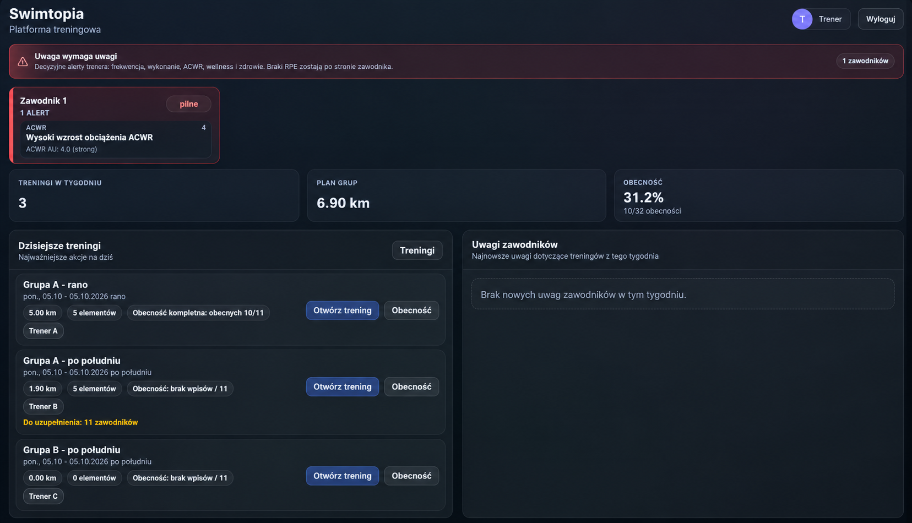
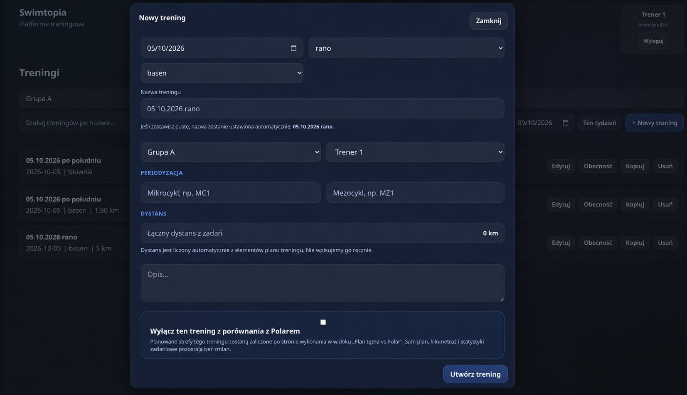
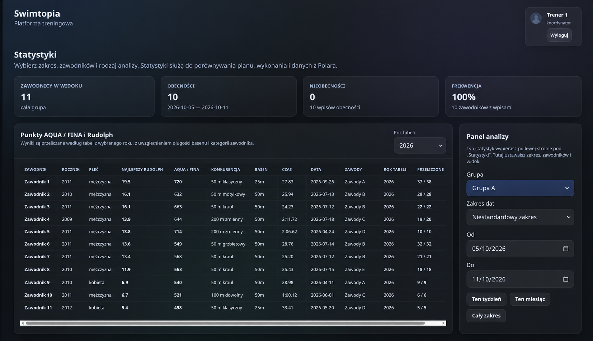
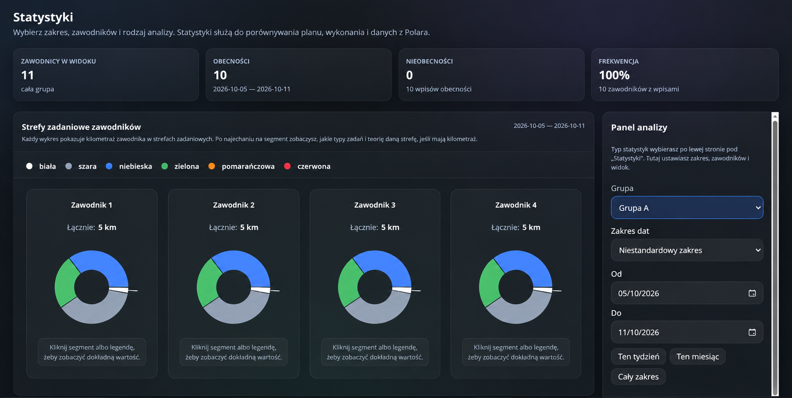
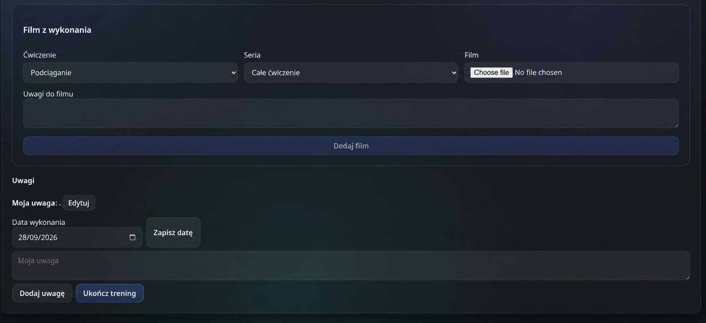
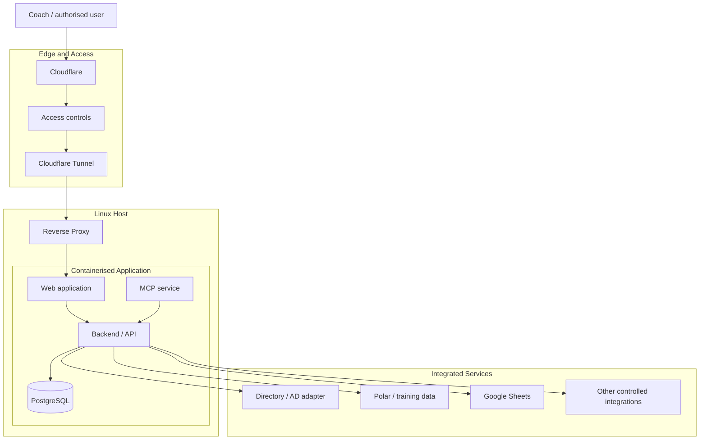
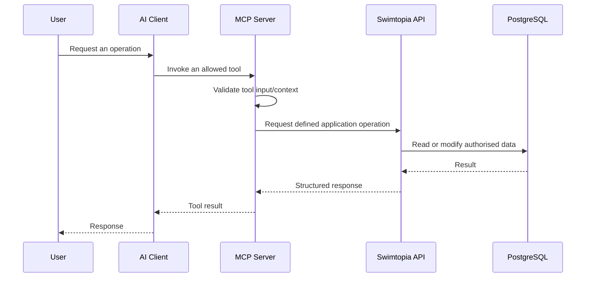

# Swimtopia

> Production training and athlete-management platform built for a sports
> club, combining training operations, performance analytics,
> integrations and controlled AI-assisted workflows.

**Status:** Production / actively developed\
**Source code:** Private / proprietary\
**Role:** Architecture, development, deployment, integrations and
platform operations

------------------------------------------------------------------------

## Project at a glance

Swimtopia is a production web platform I design, develop, deploy and
operate for a sports club.

It started as a way to consolidate training and athlete-related
workflows and has grown into a broader operational platform covering
training planning, attendance, performance analytics, strength training,
reporting, video workflows and selected AI-assisted operations.

The interesting engineering challenge is not only the application
itself. Running it in production requires work across Linux, containers,
databases, identity, networking, certificates, reverse proxies,
Cloudflare connectivity, APIs and external systems.

### Current capabilities

-   swimming training planning and execution tracking;
-   athlete and group attendance;
-   planned vs completed training volume;
-   training-zone and workload analytics;
-   Polar data comparison;
-   competition results and performance metrics;
-   AQUA/FINA and Rudolph scoring;
-   strength-training planning and exercise library;
-   athlete feedback and coaching observations;
-   video upload and backend-assisted technical analysis;
-   periodic athlete reports;
-   Google Sheets integration;
-   directory and identity integrations;
-   controlled AI access through MCP.

------------------------------------------------------------------------

## Product views

The screenshots below use anonymised/demo data. Production athlete
information is not published.

### Coach dashboard

The dashboard gives coaches an operational view of current training
activity, attendance and athletes requiring attention.

Examples of information surfaced by the dashboard include:

-   weekly training activity;
-   group training volume;
-   attendance;
-   incomplete attendance records;
-   athlete alerts;
-   workload indicators such as ACWR;
-   athlete and coach notes.

The goal is to make operational exceptions visible without requiring the
coach to manually inspect every athlete and session.

### Training creation

Training sessions can be created for a selected group, coach, date and
training type.

Training metadata also supports periodisation context and integration
with execution data. Planned distance is derived from the training
content instead of being entered independently.

Selected sessions can be excluded from Polar comparison when that
comparison would not be meaningful.

### Performance analytics

The statistics module combines attendance, competition results and
training information.

Competition results can be evaluated using AQUA/FINA and Rudolph scoring
while accounting for event, pool length and athlete category.

The platform also provides training-zone analysis:

This allows coaches to inspect the distribution of planned or completed
work across athletes and training zones.

### Strength-training library

Strength work is integrated into the platform instead of being
maintained as a completely separate dataset.

The exercise library can contain:

-   exercise descriptions;
-   technical criteria;
-   required camera angle;
-   reference video;
-   AI-analysis configuration.

This provides structured context for both coaches and technical-analysis
workflows.

### Video workflow

Athletes or coaches can attach execution videos to training work.

The visible UI is intentionally simple. The more important part of the
workflow happens behind the application interface: the backend
associates the video with training context and makes it available to
controlled analysis workflows.

AI-generated technical feedback is designed to support coaching rather
than bypass it. Observations can be reviewed before becoming part of the
athlete's coaching context.

------------------------------------------------------------------------

## Periodic reporting

Swimtopia can generate longer-period athlete summaries from structured
data collected across the platform.

A report may combine:

-   planned and completed training volume;
-   attendance;
-   weekly consistency;
-   task-type completion;
-   training-zone distribution;
-   Polar data;
-   competition history;
-   performance trends;
-   AQUA/FINA and Rudolph scores;
-   strength-training information when available;
-   RPE/wellness information when available;
-   coach observations, conclusions and recommendations.

A six-month report generated by the system, using anonymised data, is
included in this repository:

**[Example anonymised periodic
report](docs/examples/swimtopia-periodic-report-anonymized.pdf)**

The reporting workflow is deliberately data-aware. Missing RPE, wellness
or strength data is treated as missing information rather than silently
interpreted as a positive result.

------------------------------------------------------------------------

## High-level architecture

This diagram is intentionally simplified. Production hostnames,
credentials, internal network topology and security-sensitive
configuration are not published.

------------------------------------------------------------------------

## AI and MCP integration

One of the more experimental parts of Swimtopia is the use of the Model
Context Protocol (MCP) as a controlled interface between AI clients and
application capabilities.

The model does **not** receive unrestricted database or infrastructure
access.

Instead, selected application operations are exposed as purpose-built
tools.

This boundary is important because model reasoning and application
permissions are separate concerns.

MCP is used for selected workflows such as:

-   retrieving athlete and training context;
-   generating or assisting with periodic summaries;
-   technical-analysis workflows;
-   controlled creation or modification of application data;
-   coach-review workflows.

Application-side validation remains responsible for deciding whether an
operation is allowed.

------------------------------------------------------------------------

## Identity, networking and security

A significant part of the project has involved connecting
application-level functionality to real infrastructure.

Areas I have had to design or troubleshoot include:

-   authentication flows;
-   integration with Active Directory;
-   service-to-service authentication;
-   certificates and TLS;
-   Cloudflare Tunnel connectivity;
-   Cloudflare access controls;
-   reverse-proxy configuration;
-   application and API URL routing;
-   internal vs externally reachable services;
-   secrets management;
-   container networking.

These problems frequently cross layers. An authentication failure can
originate in application configuration, a certificate, a proxy, a
tunnel, DNS, an identity service or the upstream directory.

Understanding the complete request path has therefore been an important
part of operating the platform.

------------------------------------------------------------------------

## Deployment model

The current deployment process is intentionally straightforward.

``` mermaid
flowchart LR
    BUILD[Application release]
    ZIP[Release ZIP]
    COPY[Copy to Linux host]
    EXTRACT[Extract release]
    SCRIPT[Deployment script]
    CONFIG[Prepare configuration/files]
    SERVICES[Update/start services]
    VERIFY[Verify application]

    BUILD --> ZIP
    ZIP --> COPY
    COPY --> EXTRACT
    EXTRACT --> SCRIPT
    SCRIPT --> CONFIG
    CONFIG --> SERVICES
    SERVICES --> VERIFY
```

At present, a release is packaged as a ZIP archive, copied to the target
Linux machine and extracted. A deployment script then prepares the
required files/configuration and performs the application deployment
steps.

This is an area intentionally left visible in the case study rather than
presenting a CI/CD pipeline that does not yet exist. Further deployment
automation is a natural next step as the platform matures.

------------------------------------------------------------------------

## Selected engineering challenges

### Authentication and Active Directory

Connecting application workflows with directory services required
dealing with authentication boundaries, service identities and the
difference between application-facing APIs and infrastructure-facing
operations.

Rather than coupling every application component directly to directory
internals, directory operations can be placed behind controlled
adapters/interfaces.

### Certificates and TLS

Certificate problems can surface as apparently unrelated application or
authentication failures. Troubleshooting required following the
connection across services instead of treating TLS as an isolated
configuration item.

### Cloudflare Tunnel

The platform uses Cloudflare connectivity to expose selected services
without directly publishing the underlying host.

This required correctly aligning:

-   tunnel routing;
-   application hostnames;
-   access policies;
-   upstream services;
-   reverse-proxy behaviour.

### Reverse proxy and URLs

A recurring integration challenge has been ensuring that public URLs,
internal service addresses, callback paths and API routes agree across
the edge, proxy and application layers.

### Database migrations

Schema changes in a live application require migration discipline and
awareness of existing production data. Migration failures can prevent
backend services from starting, making database state part of deployment
troubleshooting.

### Container dependencies

A healthy container does not necessarily mean a healthy application.
Startup order, database availability, migrations, network connectivity
and configuration all need to be considered when diagnosing failures.

------------------------------------------------------------------------

## Engineering principles used in the project

### Expose capabilities, not infrastructure

AI clients and external consumers receive defined application
capabilities rather than direct database or infrastructure access.

### Keep integration boundaries explicit

Directory services, external data providers and AI tooling are treated
as integrations with explicit boundaries rather than being embedded
throughout unrelated application code.

### Prefer observable automation

An automated workflow needs useful failures, logs and validation. A fast
workflow that cannot explain why it failed is difficult to operate.

### Treat missing data as missing data

Analytics should not manufacture certainty. If RPE, wellness or strength
data is unavailable, the reporting layer should state that limitation.

### Production ownership includes infrastructure

The application is not finished when the code works locally.
Authentication, deployment, networking, data migrations, backups and
failure recovery are part of the system.

------------------------------------------------------------------------

## Technology overview

  -----------------------------------------------------------------------
  Area                                Technologies / concepts
  ----------------------------------- -----------------------------------
  Infrastructure                      Linux, Docker, Docker Compose

  Backend                             Python, FastAPI, REST APIs

  Data                                PostgreSQL, SQL

  Edge / connectivity                 Cloudflare, Cloudflare Tunnel,
                                      reverse proxy, HTTP/HTTPS

  Identity                            Authentication flows, Active
                                      Directory integration, service
                                      identities

  Integrations                        Polar/training data, Google Sheets,
                                      internal APIs

  AI                                  MCP, controlled tools, AI-assisted
                                      technical analysis and reporting

  Operations                          Deployment scripting, logs,
                                      troubleshooting, database
                                      migrations

  Development                         Git, API-driven architecture
  -----------------------------------------------------------------------

The table describes technologies used in this project rather than
serving as a general skills inventory.

------------------------------------------------------------------------

## Current deployment vs future direction

The platform is already production-operated, but several engineering
areas can be developed further.

Current priorities include:

-   further deployment automation;
-   stronger release validation and rollback procedures;
-   expanding observability;
-   continuing to improve integration boundaries;
-   extending structured athlete feedback such as RPE/readiness;
-   improving strength-training data coverage;
-   continuing development of controlled AI-assisted workflows.

The aim is not to automate every operation for its own sake. Automation
is introduced where it improves reliability, repeatability or
operational effort.

------------------------------------------------------------------------

## Repository scope and source-code availability

This repository is a **public engineering and product case study**, not
the production source repository.

The production source code is proprietary and is intentionally not
publicly available for two reasons:

1.  Swimtopia is being developed with future commercialisation in mind.
2.  My agreement with the club does not permit publication of the
    production code.

For the same reason, this repository does not contain:

-   athlete or user personal data;
-   production credentials or secrets;
-   private keys or certificates;
-   production hostnames;
-   internal network topology;
-   Active Directory structure;
-   security-sensitive Cloudflare configuration;
-   private API credentials.

The screenshots and example report included here are anonymised
representations of real platform workflows.

Architecture, design decisions, troubleshooting cases and implementation
trade-offs can be discussed in more detail during a technical interview.

------------------------------------------------------------------------

## What this project has taught me

Swimtopia has been especially useful as an engineering project because
failures rarely stay inside one technology.

A problem visible in the UI may ultimately involve the backend,
PostgreSQL, a container, an authentication flow, a certificate, the
reverse proxy, Cloudflare Tunnel or an external service.

Operating the platform has reinforced the value of understanding systems
across layers rather than treating application development,
infrastructure, networking and identity as completely separate areas.

It has also changed how I approach AI integrations. The useful question
is not only what a model can do, but **which capabilities the
surrounding system should allow it to exercise, under what validation
and with what review path**.

------------------------------------------------------------------------

## Privacy

All public examples in this repository should use anonymised or
synthetic data.

If you notice information in this repository that appears to identify a
real athlete, coach or production environment, please treat it as
unintended disclosure and contact the repository owner.
