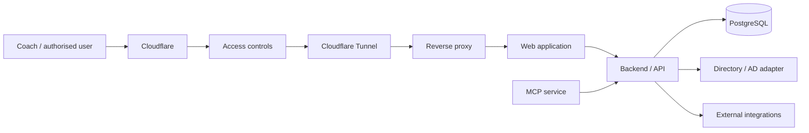

# Architecture

Swimtopia is a production training and athlete-management platform operated for a sports club.

This document describes the architecture at a high level. It intentionally omits production hostnames, credentials, internal network details and security-sensitive configuration.

## Request flow

## Main components

### Web application

Provides the user interface for coaches and authorised users.

### Backend / API

Implements application logic, data access and integration boundaries.

### PostgreSQL

Stores structured operational data used by the application.

### Reverse proxy

Routes incoming traffic to the appropriate application services.

### Cloudflare Tunnel

Provides controlled connectivity to selected services without directly exposing the host.

### Directory / AD integration

Directory-related operations are kept behind controlled interfaces rather than being spread throughout application code.

### MCP integration

Selected application capabilities are exposed to AI clients through defined MCP tools.

The model does not receive unrestricted database or infrastructure access.

## Design principles

- explicit integration boundaries;
- least-privilege access;
- secrets outside source code;
- controlled service exposure;
- application-side validation for write operations;
- clear separation between model reasoning and platform permissions;
- infrastructure details kept out of public documentation.
