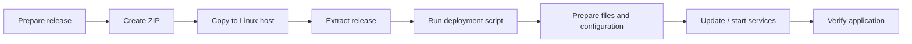

# Deployment

## Current deployment model

The current release process is intentionally simple and script-driven.

## Process

1. Prepare the application release.
2. Package the release as a ZIP archive.
3. Copy the archive to the target Linux machine.
4. Extract the release.
5. Run the deployment script.
6. The script prepares required files and configuration.
7. Application services are updated or started.
8. The deployment is verified.

## Why this is documented as-is

The repository intentionally reflects the current state rather than presenting a CI/CD workflow that is not yet in place.

The present approach is workable for the platform's current scale, but further automation is a natural next step.

## Future improvements

Potential improvements include:

- automated release packaging;
- remote deployment orchestration;
- deployment validation;
- rollback procedures;
- stronger health checks;
- CI/CD integration;
- release version tracking.
